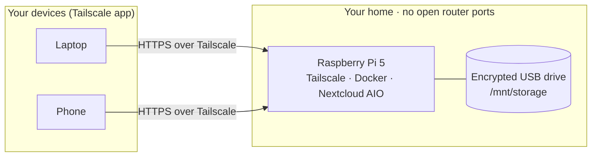

# Build Your Own Private File Server with a Raspberry Pi 5, an External Drive and Nextcloud

A step-by-step guide to a private, encrypted personal cloud that you own. Your files live on a large external drive attached to a Raspberry Pi 5 in your home. **Nextcloud** gives you Dropbox-style apps for your computer and phone, and **Tailscale** lets you reach it securely from anywhere without opening any ports on your router.

## What you'll build

**Part 1 (the core tutorial)** gives you:

- An external drive protected with full-disk encryption (LUKS), so it's unreadable if it's lost or stolen
- Nextcloud All-in-One: files, sync, calendar, chat and office documents, with desktop and phone apps
- Private HTTPS access from anywhere through Tailscale
- Automatic Nextcloud backups and updates, weekly OS updates, and a server that unlocks and restarts itself after a reboot
- Basic hardening: SSH keys, fewer running services and a locked-down Tailscale account

**Part 2 (optional bonus features)** builds on Part 1. Each bonus is standalone, except that bonus 4 needs bonuses 1 and 3:

1. **Custom domain:** serve Nextcloud at `https://example.com` through a small cloud proxy, while the Pi stays off the public internet
2. **SMB and Time Machine:** back up your Macs to the Pi
3. **Notesnook:** self-host an end-to-end encrypted note-taking app
4. **Notesnook on your custom domain:** reach Notesnook without Tailscale on every device

## Tech stack

| Layer | Component | What it does |
|---|---|---|
| Hardware | Raspberry Pi 5 (8GB recommended) with active cooler | The server |
| Hardware | External USB hard drive with its own power supply | Stores your files |
| System | Raspberry Pi OS (64-bit), SSH | Operating system and remote control |
| Storage | LUKS + ext4 | Full-disk encryption and the Linux filesystem |
| Remote access | Tailscale (Serve) | Private network with real HTTPS certificates |
| Apps | Docker + Nextcloud All-in-One (AIO) | Files, Talk, Office, Whiteboard and more |

## Cost and time

> 🕒 **Rough estimates, as of Nov 2026.** Memory shortages raised Raspberry Pi prices several times in 2025–2026, so check current prices before buying.

| Item | Rough cost (USD) |
|---|---|
| Raspberry Pi 5 (8GB), board only | about $130 list price; often $175–$200 at retailers |
| Starter kit (Pi 5 8GB + case + fan + power supply + microSD + card reader) | about $250–$270 |
| External multi-terabyte USB drive with its own power supply | varies a lot with capacity; budget roughly $150–$500+ |
| Optional UPS (battery backup) | varies |
| **Part 1 total** | **roughly $400–$800**, mostly depending on the drive |
| Bonus 1 running costs | about $5/month (cloud proxy) + $0.50/month (DNS zone) + the domain's yearly fee |

**Time:** allow a weekend for Part 1. Most of it is waiting for downloads, drive formatting and the first Nextcloud setup. The bonuses take about 1 hour each (Notesnook: 1–2 hours).

## Shopping list

- **Raspberry Pi 5** (8GB recommended)
- **Official 27W USB-C power supply.** The Pi 5 can be unreliable with other chargers.
- **Case with an active cooler** (fan and heatsink). The server runs 24/7.
- **microSD card** (32GB or larger) plus a **USB card reader** for flashing it from your computer
- **A multi-terabyte USB hard drive with its own power supply.** A desktop model is best, so the Pi doesn't have to power it.
- **For first boot only:** a monitor, a **micro-HDMI to HDMI** cable or adapter, and a keyboard and mouse (USB or Bluetooth)
- **Ethernet cable**
- Optional: a **UPS** (battery backup), so power blips don't restart the server

## Placeholders used in this tutorial

Everywhere you see one of these, type your own value instead. The examples are made up.

| Placeholder | Meaning | Example | How to find yours |
|---|---|---|---|
| `<username>` | Your login name on the Pi | `alex` | You choose it when flashing the OS (chapter 1). On the Pi: `whoami` |
| `<hostname>` | The Pi's network name | `homeserver` | You choose it when flashing the OS. On the Pi: `hostname` |
| `<pi-lan-ip>` | The Pi's local (home network) IP address | `192.168.1.50` | On the Pi: `ip -4 addr show eth0` (chapter 2) |
| `<router-ip>` | Your router's IP address | `192.168.1.1` | On the Pi: `ip route \| grep default` |
| `<pi-tailscale-ip>` | The Pi's Tailscale IP | `100.x.y.z` | On the Pi: `tailscale ip -4` (chapter 4) |
| `<tailnet>` | Your tailnet's DNS name | `tail1234ab.ts.net` | Tailscale admin console → **DNS** page (chapter 4) |
| `<hostname>.<tailnet>` | The Pi's full Tailscale name; also your Nextcloud address | `homeserver.tail1234ab.ts.net` | Tailscale admin console → **Machines** |
| `<luks-uuid>` | The encrypted partition's UUID | `xxxxxxxx-xxxx-xxxx-xxxx-xxxxxxxxxxxx` | `sudo cryptsetup luksUUID /dev/sdX1` (chapter 3) |
| `/dev/sdX`, `/dev/sdX1` | The external drive and its partition | `/dev/sda`, `/dev/sda1` | `lsblk` (chapter 3) |
| `<nextcloud-user>` | A Nextcloud account name | `alex` | The account you create in Nextcloud (chapter 5) |
| `<Region/City>` | Your time zone | `Europe/Berlin` | On the Pi: `timedatectl` |
| `<your-domain>` | A domain you own (bonus 1) | `example.com` | Route 53 → **Registered domains** |
| `<static-ip>` | The cloud proxy's public IP (bonus 1) | `203.0.113.10` | Lightsail → instance → **Networking** |
| `<smb-user>` | The Samba user for Time Machine (bonus 2) | `tmuser` | You choose it (bonus 2) |

The guide always calls the unlocked drive `storage` and mounts it at `/mnt/storage`. You can use other names, but then you have to change them everywhere.

## Contents

### Part 1: core

1. [Hardware and OS](part-1-core/01-hardware-and-os.md): parts, assembly, flashing the OS
2. [First boot and SSH](part-1-core/02-first-boot-and-ssh.md): first boot, Ethernet, SSH, a fixed IP address
3. [Encrypted storage](part-1-core/03-encrypted-storage.md): LUKS, ext4, header backup, an unlock command
4. [Tailscale](part-1-core/04-tailscale.md): secure remote access and HTTPS
5. [Docker and Nextcloud](part-1-core/05-docker-and-nextcloud.md): Nextcloud All-in-One on the encrypted drive
6. [Maintenance and automation](part-1-core/06-maintenance-and-automation.md): backups, unlock at boot, weekly updates, auto-restart
7. [Security and hardening](part-1-core/07-security-and-hardening.md): SSH keys, fewer services, Tailscale account, secrets checklist

### Part 2: bonus features

1. [Custom domain](part-2-bonus/01-custom-domain.md): Route 53 + a Lightsail proxy running Caddy
2. [SMB and Time Machine](part-2-bonus/02-smb-and-time-machine.md): Mac backups to the Pi
3. [Notesnook](part-2-bonus/03-notesnook.md): a self-hosted, encrypted notes server
4. [Notesnook on your custom domain](part-2-bonus/04-notesnook-custom-domain.md): public URLs for Notesnook through the same proxy

## Before you start

- **Back up everything on the external drive.** Chapter 3 **erases it completely**. Open a few of the backed-up files to confirm the backup works.
- **Use a password manager.** You'll create several passwords, passphrases and keys. Losing some of them means losing your data. Chapter 7 has a checklist.

## Conventions

- Commands in `bash` blocks run **on the Pi** over SSH unless the step says "on your computer".
- 🕒 marks version-sensitive details (prices, release numbers, known bugs). They were checked in Nov 2026, so look at the upstream docs before relying on them.
- ⚠️ marks steps that can destroy data or lock you out. Read them twice.
- Each chapter ends with a **Troubleshooting** section.
