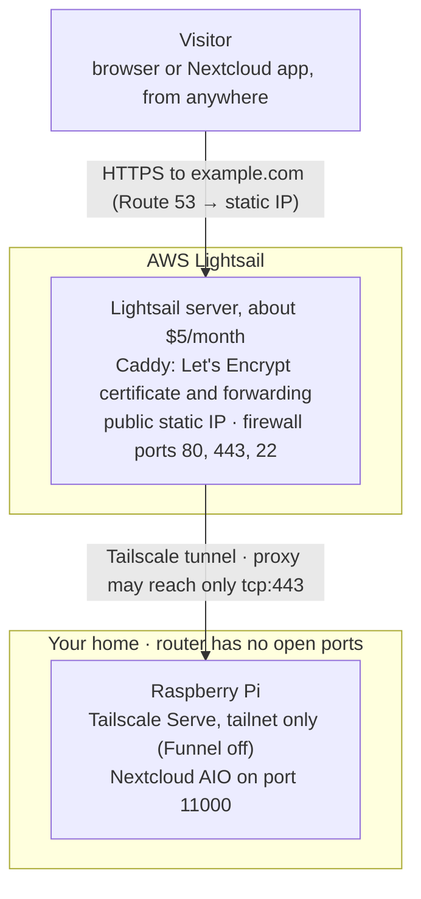

# Bonus 1: Put Nextcloud on your own domain (Route 53 + Lightsail + Caddy)

A small cloud server becomes the public front door for your home Nextcloud, so `https://<your-domain>` serves the Pi, while the Pi itself stays off the public internet. The cloud server runs **Caddy** (automatic HTTPS and forwarding) and joins your tailnet, so it reaches the Pi over Tailscale with no open ports on your home router.

**Requires:** Part 1 finished.



The public only ever talks to the Lightsail server. The Pi accepts traffic from your tailnet alone.

**Why not the simpler-looking options?** 🕒 *As of Nov 2026:*

- **A CNAME to your ts.net name, or Tailscale Funnel with a custom domain:** Funnel only serves `*.ts.net` names. It routes by the hostname in the TLS handshake, so a different domain fails or shows a certificate warning.
- **CloudFront in front of Funnel:** works for page loads, logins and API calls, but CloudFront rejects the WebDAV methods (PROPFIND, MOVE, MKCOL) that Nextcloud's file browser and sync apps use.
- **Cloudflare Tunnel:** a good free alternative, but it means moving your DNS to Cloudflare, and the free plan caps uploads at 100MB per request.

**Cost** 🕒 *(as of Nov 2026):* about $5/month for the Lightsail instance (the static IP is free while attached), $0.50/month for the Route 53 hosted zone, plus the domain's yearly registration fee. AWS has offered the first three months of the $5 plan free.

**Time:** 45 to 60 minutes the first time.

> ⚠️ **This changes your Nextcloud address permanently.** After Part 5, the `<hostname>.<tailnet>` address no longer works for Nextcloud, even on your own tailnet. All desktop and phone apps must reconnect using `https://<your-domain>`. Passkeys are tied to the old address, so you'll probably need to register them again. Your Nextcloud also becomes reachable by the whole internet, so finish chapter 5, Step 6 (2FA) first.

## Before you start

You need an AWS account. Collect these values; the rest of this guide uses the placeholders in the left column.

| Placeholder | What it is | How to find it |
|---|---|---|
| `<your-domain>` | Your domain, e.g. `example.com` | Route 53 → **Registered domains** (Part 0) |
| `<hostname>.<tailnet>` | The Pi's full Tailscale name | `tailscale status` on the Pi, or the Machines page |
| `<pi-tailscale-ip>` | The Pi's Tailscale IP | `tailscale ip -4` on the Pi |
| `<static-ip>` | The Lightsail server's public IP, e.g. `203.0.113.10` | Part 1 below |

Also make sure:

- **Every computer you manage this from has Tailscale installed and signed in** to the same account as the Pi. If `ping <pi-tailscale-ip>` fails from your laptop, fix that first.
- **You have the AIO passphrase.** If you've lost it, see chapter 5's troubleshooting.
- **Your Nextcloud admin account has two-factor login turned on.**

## Part 0: Buy a domain in Route 53

If you don't own a domain yet: in the AWS console, open **Route 53 → Registered domains → Register domains**, search for a name and complete the purchase. AWS creates a **hosted zone** for it automatically, which is where you'll add records in Part 2. Registration can take from a few minutes to a few hours.

**Check:** the domain shows under **Registered domains**, and **Hosted zones** lists a zone with the same name.

## Part 1: Create the Lightsail server

The proxy is a bare Ubuntu server on the $5 plan, with a static IP and three firewall ports open.

1. In the Lightsail console, click **Create instance** and pick the region closest to you.
2. Under **Platform**, pick the **OS only** option (not "Linux apps"). Under **Blueprint**, pick **Ubuntu 24.04 LTS**. Ignore app blueprints such as WordPress.
3. Keep the default SSH key. You'll connect with the browser's **Connect using SSH** button.
4. Leave **automatic snapshots** off. A proxy is quicker to rebuild than to restore.
5. Choose the **$5/month plan with public IPv4**. The cheaper IPv6-only plan can't be reached by many visitors.
6. Name it `nas-proxy` and click **Create instance**. Wait until it shows **Running**.
7. On the instance's **Networking** tab, click **Attach static IP**, create one and attach it. Write it down; it's `<static-ip>`.
8. In the firewall rules on the same tab, click **+ Add rule** and choose **HTTPS** (TCP 443). The form requires source addresses: click **Add** and enter `0.0.0.0/0` (any IPv4), then **Add** again for `::/0` (any IPv6). Click **Add rule**.

**Check:** you have three firewall rules: HTTP (80), HTTPS (443) and SSH (22). Keep port 80, because Caddy uses it to get its certificate and to redirect visitors to HTTPS.

If the server's welcome message says a new Ubuntu release is available, ignore it. 🕒 Ubuntu 24.04 gets security updates until 2029, and in-place release upgrades aren't worth the risk on a proxy.

## Part 2: Point the domain at the server

One `A` record in Route 53 sends `<your-domain>` to the Lightsail static IP.

1. Open **Route 53 → Hosted zones → `<your-domain>`**.
2. Click **Create record**.
3. Leave **Record name** blank (that means the bare domain), set **Record type** to **A**, set **Value** to `<static-ip>`, and set **TTL** to 300.
4. Click **Create records**.
5. Optional: add a second `A` record named `www` with the same IP, and add `www.<your-domain>` to the Caddyfile in Part 4.

**Check:** after a few minutes, on your laptop, `dig +short <your-domain>` prints `<static-ip>`. Do this before Part 4, because Caddy can only get a certificate once the domain resolves.

## Part 3: Put the server on your tailnet

The proxy joins the same Tailscale account as the Pi, which gives it a private route to Nextcloud.

1. On the instance page, click **Connect using SSH**.
2. Update the system and install Tailscale:

   ```bash
   sudo apt update && sudo apt upgrade -y
   curl -fsSL https://tailscale.com/install.sh | sh
   sudo tailscale up --hostname=nas-proxy
   ```

3. Open the link it prints and sign in with the **same account and login provider** as the Pi.
4. On the Tailscale **Machines** page, open the menu next to **nas-proxy** and choose **Disable key expiry**. (You did the same for the Pi in chapter 4.) Otherwise the proxy drops off the tailnet after about six months and the site goes down.
5. Confirm the proxy can reach Nextcloud on the Pi:

   ```bash
   curl -I https://<hostname>.<tailnet>/login
   ```

**Check:** you get an `HTTP/2 200` or `302` response, which means the route works.

## Part 4: Install Caddy on the server

Caddy gets a free Let's Encrypt certificate for your domain, renews it automatically, and forwards every request to the Pi over Tailscale.

1. Install it and open its config file:

   ```bash
   sudo apt install -y caddy
   sudo nano /etc/caddy/Caddyfile
   ```

2. Replace everything in the file with:

   ```
   <your-domain> {
       encode zstd gzip
       reverse_proxy https://<hostname>.<tailnet>
   }
   ```

   - `encode zstd gzip` compresses responses.
   - `reverse_proxy` forwards each request over Tailscale to the Pi's Tailscale Serve address, which hands it to Nextcloud.

3. Save (**Ctrl + O**, **Enter**), exit (**Ctrl + X**), then reload Caddy and watch its log:

   ```bash
   sudo systemctl reload caddy
   sudo journalctl -u caddy -f
   ```

4. Within a minute, the log reports a certificate obtained for your domain. Press **Ctrl + C**.

**Check:** open `https://<your-domain>/login`. You reach the Pi. Until Part 5, Nextcloud may show an **"Access through untrusted domain"** page or bounce you to the ts.net address. Either one proves the route works, because Nextcloud doesn't know the new name yet.

## Part 5: Tell Nextcloud its new name

AIO rewrites Nextcloud's domain settings every time its containers start, so the usual `occ config:system:set` commands don't stick. Change the domain in AIO's own config instead.

1. Check the current domain on the Pi:

   ```bash
   sudo docker exec nextcloud-aio-mastercontainer grep -o '"domain": *"[^"]*"' /mnt/docker-aio-config/data/configuration.json
   ```

2. Open the AIO admin page at `https://<pi-tailscale-ip>:8080`. If it says direct login is blocked because Nextcloud is running, either use the **Open Nextcloud AIO interface** button under Nextcloud's **Administration settings → Overview**, or run `sudo docker stop nextcloud-aio-apache` and log in with the passphrase.
3. Click **Stop containers**. Don't log out of the AIO page; if you do, you'll need the passphrase to get back in.
4. Edit the config:

   ```bash
   sudo docker run -it --rm --volume nextcloud_aio_mastercontainer:/mnt/docker-aio-config:rw alpine sh -c "apk add --no-cache nano && nano /mnt/docker-aio-config/data/configuration.json"
   ```

5. Press **Ctrl + W**, search for `"domain"`, and change its value to `"<your-domain>"`. Keep the quotes and the trailing comma. Save and exit.
6. Back on the AIO page, click **Start and update containers** and wait until every container is green.

**Check:** the command from step 1 now prints your domain. Open `https://<your-domain>/login`, log in and browse a few folders. The address bar stays on your domain.

From now on, use `https://<your-domain>` everywhere, including the desktop and phone apps.

## Part 6: Make sure Funnel is off

If you turned on Funnel for public share links ([chapter 7, Step 4](../part-1-core/07-security-and-hardening.md#step-4-public-share-links-with-tailscale-funnel-optional)), turn it off now. Your domain is now the public way in.

1. On the Pi:

   ```bash
   tailscale funnel status
   ```

2. If it shows `(Funnel on)`, turn it off and make sure the tailnet-only Serve entry is back:

   ```bash
   sudo tailscale funnel --https=443 off
   sudo tailscale serve --bg http://127.0.0.1:11000
   tailscale serve status
   ```

   > ⚠️ Don't use `tailscale serve reset` or `tailscale funnel reset` here. They remove **every** Serve entry, including Notesnook's if you've done bonus 3.

**Check:** the status shows `(tailnet only)` with no Funnel line, and the Pi has no **Funnel** label on the Machines page. Then, from your phone with **Wi-Fi off and Tailscale disconnected**, `https://<your-domain>` loads and `https://<hostname>.<tailnet>` doesn't. Test from the phone, not your laptop: a laptop still on Tailscale, or with a cached redirect, gives a misleading result.

## Part 7: Lock down the proxy

By default, every device on a tailnet can reach every other device. That means a compromised proxy could reach your laptop or the Pi's SSH. These rules limit the proxy to Nextcloud on the Pi, and they also turn off Funnel for the whole tailnet.

> ⚠️ **Lockout risk.** This replaces Tailscale's "allow everything" default policy. Keep an SSH session to the Pi open while you save it. The admin console keeps a history of the policy, so you can roll back.

1. In the Tailscale admin console, open **Access controls**, replace the policy with the one below (put in the Pi's Tailscale IP), and click **Save**. The `tests` block makes Tailscale refuse to save if the proxy could reach SSH or the AIO admin page.

   ```json
   {
   	"tagOwners": {
   		"tag:proxy": ["autogroup:admin"],
   	},

   	"hosts": {
   		"homeserver": "<pi-tailscale-ip>",
   	},

   	"grants": [
   		// Your own devices can reach each other freely
   		{"src": ["autogroup:member"], "dst": ["*"], "ip": ["*"]},

   		// The proxy can reach only Nextcloud (via Tailscale Serve on 443) on the Pi
   		{"src": ["tag:proxy"], "dst": ["homeserver"], "ip": ["tcp:443"]},
   	],

   	// Tailscale's default SSH rule, kept as-is
   	"ssh": [
   		{
   			"action": "check",
   			"src":    ["autogroup:member"],
   			"dst":    ["autogroup:self"],
   			"users":  ["autogroup:nonroot", "root"],
   		},
   	],

   	// No "funnel" nodeAttrs entry: Funnel is off tailnet-wide.

   	"tests": [
   		{"src": "tag:proxy", "accept": ["homeserver:443"], "deny": ["homeserver:22", "homeserver:8080"]},
   	],
   }
   ```

   The rule allows port **443**, not 11000. Caddy connects to the Pi's Tailscale Serve address on 443, and Nextcloud's port 11000 only listens inside the Pi (`127.0.0.1`).

2. On the Machines page, open the menu next to **nas-proxy**, choose **Edit ACL tags…**, add `tag:proxy`, and save. Until it's tagged, the proxy counts as one of your own devices, so nothing breaks between steps 1 and 2.

**Check:**

- `https://<your-domain>` still loads.
- SSH from your own devices to the Pi still works.
- From the proxy, `curl -m 5 http://<pi-tailscale-ip>:8080` times out.
- Key expiry is still disabled for nas-proxy (tagging can change it).

The key change from Tailscale's default policy: the allow-everything rule now starts from `autogroup:member` (your own devices) instead of `*`. Tagged devices only get what you grant them explicitly.

### Harden the proxy server itself

- **Firewall:** allow only ports 80 and 443 from anywhere. For SSH, either remove public access and connect over Tailscale, or limit it to your own IP.
- **Updates:** keep it patched. Reuse the update script from [chapter 6](../part-1-core/06-maintenance-and-automation.md#step-5-a-weekly-update-script), or install `unattended-upgrades`.
- **SSH:** use key-based login only. Lightsail sets this up by default.

## Part 8: Add more domains later

The same server can front any number of domains, each with its own automatic certificate. Each new one takes up to three changes:

1. **Route 53:** an `A` record for the new name pointing at `<static-ip>`.
2. **Caddyfile:** a new block, then `sudo systemctl reload caddy`. For example:

   ```
   photos.example.com {
       reverse_proxy http://homeserver:2283        # another app on the Pi
   }

   media.example.org {
       reverse_proxy http://<other-device>:8096    # another device on your tailnet
   }

   old-site.example.net {
       redir https://example.com{uri} permanent
   }
   ```

3. **Tailscale policy,** only when the target is on your tailnet: allow the proxy to reach it. Add a port to the existing rule, or add a host and a rule:

   ```json
   {"src": ["tag:proxy"], "dst": ["homeserver"], "ip": ["tcp:443", "tcp:2283"]},
   {"src": ["tag:proxy"], "dst": ["<other-device>"], "ip": ["tcp:8096"]},
   ```

If you end up exposing many machines, tag them (for example `tag:web`) and grant `tag:proxy` access to `tag:web` instead of listing each one. Public targets and redirects need no policy change. Each app may also need its own trusted-domain setting, as Nextcloud did.

[Bonus 4](04-notesnook-custom-domain.md) applies this pattern to Notesnook.

## Troubleshooting

| Symptom | Likely cause | Fix |
|---|---|---|
| Can't reach the Pi's `100.x` address from your laptop | Tailscale isn't installed, is signed out, or uses a different account on the laptop | Install the Tailscale app, sign in with the Pi's account and provider, then `tailscale ping homeserver` |
| AIO page: "direct login is blocked" | Nextcloud is running | Use the AIO button in Nextcloud's admin overview, or `sudo docker stop nextcloud-aio-apache` |
| Lightsail firewall says "add at least one" source | The form requires source addresses | Add `0.0.0.0/0` and `::/0` |
| `curl` from the proxy to the Pi fails | The proxy isn't on the tailnet, or a policy blocks it | Run `tailscale status` on the proxy; check that the Part 7 policy allows `tcp:443` to the Pi |
| Caddy doesn't get a certificate | DNS isn't pointing at the server yet, or port 80 is closed | `dig +short <your-domain>`; check the HTTP rule in the Lightsail firewall |
| "Access through untrusted domain" page | Nextcloud doesn't know the new domain | Redo Part 5, and confirm the config edit saved |
| Pages bounce to the ts.net address | Nextcloud still builds links with the old name | Finish Part 5 |
| Site down after about six months | Tailscale key expired on the proxy or the Pi | Disable key expiry for both on the Machines page |
| A new site behind the proxy times out | No policy rule for that device or port | Add a grant for it (Part 8) |
| Notesnook stopped working after Part 6 | A `serve reset` removed its Serve entries | Recreate them ([bonus 3, Step 4](03-notesnook.md#step-4-publish-the-server-over-https-with-tailscale-serve)) |

Useful logs: `sudo journalctl -u caddy -n 50` on the proxy, and `tailscale serve status` and `sudo docker ps` on the Pi.
