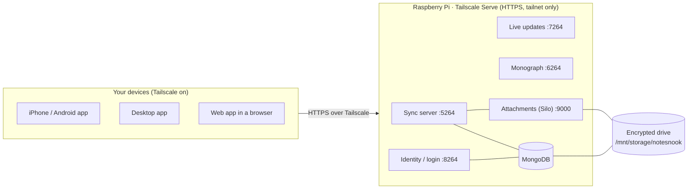

# Bonus 3: Self-host Notesnook on your Pi

Notesnook is an end-to-end encrypted note-taking app for phone, desktop and web. In this bonus you run its sync server in Docker on your Pi, keep its data on the encrypted drive, and reach it from every device over Tailscale with HTTPS. Plan on about 1–2 hours the first time.

**Requires:** Part 1 finished. Docker, the encrypted drive, the `wait-for-storage.conf` override and Tailscale HTTPS are already set up, so this bonus only adds what's new.

Why this design:

- **Tailscale instead of opening ports.** 🕒 As of Nov 2026, the self-hosted server is still officially pre-release (beta). Keeping it off the public internet removes most of the risk, and Tailscale gives you real HTTPS certificates, which the iPhone app and the web app require. (To make it public anyway, see [bonus 4](04-notesnook-custom-domain.md).)
- **Data on the encrypted drive, not the microSD card.** Databases wear out and corrupt microSD cards. Docker already waits for the drive (Part 1), so the server never starts against an empty folder.
- **Pinned versions and auto-restart.** Every service comes back after a restart or crash, and the main Notesnook images don't update themselves under you.



Nothing on the Pi is reachable except through Tailscale, and the server only ever sees encrypted notes.

**The trade-off:** every device that syncs needs the Tailscale app turned on, including a computer where you use the web app. A friend's computer won't reach your notes unless it joins your tailnet.

**The three files** you need are in [`notesnook-files/`](notesnook-files/):

- [`docker-compose.yml`](notesnook-files/docker-compose.yml): Notesnook's official compose file with the Pi-specific changes listed at its top
- [`env.example`](notesnook-files/env.example): the settings template
- [`backup.sh`](notesnook-files/backup.sh): the nightly server backup

## Before you start

SSH into the Pi, make sure the drive is unlocked, and run these checks:

| Check | Command | You want |
|---|---|---|
| 64-bit OS | `uname -m` | `aarch64` |
| Free ports | `sudo ss -tlnp \| grep -E ':(5264\|6264\|7264\|8264\|9000)\b'` | No output. If something already uses one of these ports, see Troubleshooting. |
| Drive mounted | `df -Th /mnt/storage` | `/dev/mapper/storage`, type `ext4` |
| Kernel page size | `getconf PAGESIZE` | Note the number. `16384` is the Pi 5 default and is usually fine; Troubleshooting covers what to do if the database crash-loops. |

**Nextcloud doesn't conflict with this.** It uses port 11000 and Tailscale Serve on the standard HTTPS port (443). Notesnook uses its own ports, both locally and in Serve.

## Step 1: Create the folders and copy the files

1. On the Pi, create the folders. The config lives in your home folder; the data lives on the encrypted drive:

   ```bash
   mkdir -p ~/notesnook
   sudo mkdir -p /mnt/storage/notesnook/{db,s3,backups}
   ```

2. Copy the three files to the Pi. **On your computer**, in the folder where you downloaded them:

   ```bash
   scp docker-compose.yml env.example backup.sh <username>@<hostname>:~/notesnook/
   ```

**Check:** on the Pi, `ls ~/notesnook` lists the three files.

> Your `.env` file (next step) holds secrets and stays in `~/notesnook` on the microSD card. Keep the microSD card as safe as the Pi itself.

## Step 2: Configure and start the server

1. **Create `.env` with random secrets filled in:**

   ```bash
   cd ~/notesnook
   cp env.example .env && chmod 600 .env
   sed -i "s|^NOTESNOOK_API_SECRET=.*|NOTESNOOK_API_SECRET=$(openssl rand -hex 32)|" .env
   sed -i "s|^MINIO_ROOT_PASSWORD=.*|MINIO_ROOT_PASSWORD=$(openssl rand -hex 24)|" .env
   ```

2. **Put in your Pi's Tailscale name.** It's the same `<hostname>.<tailnet>` name Nextcloud uses (chapter 4). On the Pi, `tailscale status --json | grep -m1 DNSName` also shows it; ignore the dot at the end.

   ```bash
   sed -i 's/homeserver.tail1234ab.ts.net/<hostname>.<tailnet>/g' .env
   ```

3. **Check the file.** Open it with `nano .env` and make sure:
   - `NOTESNOOK_DATA_DIR=/mnt/storage/notesnook`
   - the four `*_PUBLIC_URL` lines contain your name and keep their ports
   - `DISABLE_SIGNUPS=false` for now

   Save with **Ctrl + O**, **Enter**, **Ctrl + X**.

4. **Download the images:**

   ```bash
   sudo docker compose pull
   ```

   **Check:** everything downloads without errors. If one fails with `no matching manifest for linux/arm64`, that image has no Pi version at that tag. Stop here and check the project's GitHub releases and issues before going further.

5. **Start it:**

   ```bash
   sudo docker compose up -d
   ```

6. **Wait 2–3 minutes, then check:**

   ```bash
   sudo docker compose ps -a
   ```

   **Check:** the six long-running services (`notesnook-db`, `notesnook-s3`, `identity-server`, `notesnook-server`, `sse-server`, `monograph-server`) say `healthy`, and `autoheal` is running. `validate` and `setup-s3` say `Exited (0)`. That's normal, because they're one-time setup steps.

7. **Confirm each service answers:**

   ```bash
   for u in 5264/version 8264/version 7264/version 6264/api/version; do curl -s http://127.0.0.1:$u; echo; done
   ```

   **Check:** you see four short JSON replies with the ids `notesnook-sync`, `auth`, `sse` and `monograph`.

## Step 3: Make sure it starts after a restart

The services use `restart: unless-stopped`, so they come back whenever Docker starts. Because Docker waits for the encrypted drive (Part 1), Notesnook starts:

- **automatically at boot**, if you set up automatic unlocking ([chapter 6, Step 4](../part-1-core/06-maintenance-and-automation.md#step-4-unlock-the-drive-automatically-at-boot-optional)), or
- **when you run `unlock-storage`**, if you unlock by hand.

There's nothing to add here.

## Step 4: Publish the server over HTTPS with Tailscale Serve

The services only listen on the Pi itself (`127.0.0.1`). Tailscale Serve puts HTTPS in front of each one, reachable only by your devices. The settings survive restarts.

1. **Turn on all five:**

   ```bash
   for p in 5264 8264 7264 6264 9000; do
     sudo tailscale serve --bg --https=$p http://127.0.0.1:$p
   done
   tailscale serve status
   ```

   **Check:** the status still shows Nextcloud's entry on the standard port, **plus** five `https://<hostname>.<tailnet>:<port>` entries, each pointing at `http://127.0.0.1:<same port>`.

   > ⚠️ Never run `tailscale serve reset` or `tailscale funnel reset` unless you mean to recreate every entry. They remove Nextcloud's entry and these five.

2. **Test from another device** that has Tailscale on. Open `https://<hostname>.<tailnet>:5264/version` in a browser. The first visit can take a few seconds while the certificate is issued.

   **Check:** you see the same JSON as in Step 2, with a padlock and no certificate warning.

| Port | Service | Goes in the app's field |
|---|---|---|
| 5264 | Sync server | Sync server URL |
| 8264 | Login (identity) | Auth server URL |
| 7264 | Live updates (events) | Events server URL |
| 6264 | Published notes (Monograph) | Monograph server URL |
| 9000 | Attachments (Silo) | Not entered: the server hands it to the apps |

## Step 5: Create your account on the first device

Use the Mac or Windows desktop app for this; it's the easiest place to save backups later. Download it from notesnook.com/downloads.

1. **Point the app at your server.** Open Notesnook without logging in, go to **Settings → Servers**, and fill in the four URLs from the table above, for example `https://<hostname>.<tailnet>:5264` for the sync server. The fields are locked while you're logged in, so if you already signed in to Notesnook's own servers, log out first.
2. **Click Test connection.** It checks all four. When it says it's connected, click **Save**. The app reloads after 5 seconds.
3. **Sign up** with your email and a strong password. No confirmation email is sent: self-hosted accounts are confirmed automatically, and every paid feature is unlocked.
4. **Save your recovery key.** Your notes are end-to-end encrypted. If you lose both your password and this key, nobody can recover them, including you. Save the key from the account section of Settings into your password manager now.
5. **Turn on two-factor login with an authenticator app.** Your server can't send emails, so don't pick the email method. Use **Settings → Auth** to set it up with an authenticator app, and store the recovery codes with your recovery key.
6. **Quick test.** Create a note with a word in it, attach a small image, and wait a few seconds for the sync indicator to finish.

**Check:** the sync indicator shows that everything is synced. You'll confirm the note arrives on another device in the next step.

## Step 6: Lock sign-ups, connect other devices, import your notes

1. **Lock sign-ups** so your account is the only one:

   ```bash
   cd ~/notesnook
   sed -i 's/^DISABLE_SIGNUPS=false/DISABLE_SIGNUPS=true/' .env
   sudo docker compose up -d
   ```

   **Check:** `grep DISABLE_SIGNUPS .env` prints `DISABLE_SIGNUPS=true`.

2. **Connect each other device** the same way as Step 5, but **log in** instead of signing up:
   - **iPhone and Android:** install Notesnook, open **Settings → Servers** before logging in, enter the four URLs, test, save, then log in. Tailscale must be on. On the iPhone, turn on **VPN On Demand** in the Tailscale app's settings so it reconnects by itself. On Android, set Tailscale as the always-on VPN in system settings if you want the same.
   - **Another desktop app:** same as Step 5.
   - **Browser:** go to app.notesnook.com, open **Settings → Servers**, enter the URLs, then log in. The page comes from Notesnook, but your notes go only to your Pi. The computer needs Tailscale running.

   **Check:** on each device, your test note and its image from Step 5 show up. If the note appears but the image doesn't, see Troubleshooting.

3. **Bring over your Nextcloud notes.** Nextcloud's Notes app keeps them as Markdown files:
   - In Nextcloud's web **Files** view, select the **Notes** folder and download it (it comes as a .zip).
   - In the Notesnook desktop app, go to **Settings → Importer**, choose **Markdown**, and pick the .zip or the unzipped files.
   - Check a few notes afterward. Text and headings carry over well. Nextcloud's category folders may not map perfectly to notebooks, so tidy those by hand.
   - Keep the Nextcloud copy for a few weeks until you trust the new setup.

## Step 7: Backups

Set up two kinds. App backups let you move to Notesnook's own servers in minutes; server backups let you rebuild the Pi without touching your devices.

**1. App backups (most important).** In the desktop app, go to **Settings → Backup & export**, turn on automatic backups (daily), and pick a folder. Each backup is a single `.nnbackupz` file you can restore into any Notesnook account. Keep backup encryption on; it uses your account password.

**2. Server backups, nightly on the Pi.** `backup.sh` saves a database dump and a mirror of the attachments to `/mnt/storage/notesnook/backups`. Database dumps are kept for 14 days. The attachments copy is a single mirror of the current files, so an attachment you delete disappears from it at the next run.

The script needs `rsync`, which may not be installed on a fresh Pi:

```bash
sudo apt install -y rsync
chmod +x ~/notesnook/backup.sh
sudo ~/notesnook/backup.sh
```

**Check:** the last command prints `Backup OK: …`.

Now schedule it:

```bash
sudo crontab -e
```

Add this line at the bottom, then save:

```
30 3 * * * /home/<username>/notesnook/backup.sh >> /var/log/notesnook-backup.log 2>&1
```

**To restore a database dump** onto a fresh server, start the stack, then run:

```bash
sudo docker compose exec -T notesnook-db mongorestore --archive --gzip --drop < /mnt/storage/notesnook/backups/db/<file>
```

Then copy `backups/s3/current/` back into `/mnt/storage/notesnook/s3/`.

**3. Keep a copy off the Pi.** Everything above lives on one drive, so one drive failure takes it all. The app backups on your computer are already a second copy. For the server backups, copy the `backups` folder to another disk or a cloud bucket now and then. A tool such as `rclone` works well for this.

## Day to day

Once it's running, the server looks after itself: services restart after restarts, and `autoheal` restarts anything that stops responding. Run these from `~/notesnook`:

| Task | Command |
|---|---|
| Check health | `sudo docker compose ps` (everything `healthy`) |
| See errors from one service | `sudo docker compose logs --tail 100 notesnook-server` |
| Restart everything | `sudo docker compose restart` |
| Stop / start | `sudo docker compose down` / `sudo docker compose up -d` |
| Check last night's backup | `sudo tail -5 /var/log/notesnook-backup.log` |

### Updating

The main Notesnook images are pinned to a release tag, so they don't update on their own. Every month or two:

1. Check the latest release tag on github.com/streetwriters/notesnook-sync-server/releases. 🕒 As of Nov 2026, it's `v1.0-beta.52` (released 9 Nov 2026, marked pre-release).
2. Run `sudo ~/notesnook/backup.sh` first.
3. Change `NOTESNOOK_VERSION` in `.env` to the new tag, then run `sudo docker compose pull && sudo docker compose up -d`.
4. Open a note on your phone and on a computer to confirm sync still works. If not, set the old tag back and run `sudo docker compose up -d`.

> 🕒 Two images aren't pinned, the same as in the official compose file: `monograph-server` and `autoheal` use `:latest`, so every `pull` may update them too.

Keep the apps updated as usual. **Leave `mongo:7.0.12` alone.** 🕒 As of Nov 2026, MongoDB 8.0.5 and later crash-loop on the Pi 5 with exit code 139. MongoDB's issue tracker has the report (SERVER-129295), closed as a duplicate of another issue. Check it before trying a newer MongoDB.

## Troubleshooting

Most problems are one of the cases below. If none fits, read `sudo docker compose ps -a` and `sudo docker compose logs --tail 80 <service>`. The failing service's log usually names the problem.

| What you see | Likely cause | Fix |
|---|---|---|
| **Test connection** fails in the app | Tailscale is off on that device, there's a typo in a URL, or Serve isn't set up | Turn Tailscale on. Check each URL starts with `https://` and has the right port. Run `tailscale serve status` on the Pi. |
| "Server version mismatch" | The app is newer than your server | Update the server (Day to day) |
| `validate` exits with an error | A required line in `.env` is empty | The error names the setting. Fill it in and run `sudo docker compose up -d`. |
| `notesnook-db` keeps restarting (exit code 139, or "page size" in its logs) | The Pi 5's 16K-page kernel | Add `kernel=kernel8.img` on its own line at the end of `/boot/firmware/config.txt`, restart, then `sudo docker compose up -d`. ⚠️ This switches the **whole Pi** to a different kernel, which affects Nextcloud too. Remove the line to undo it. |
| Notes sync but images and files don't | The attachments address (port 9000) isn't reachable or doesn't match `.env` | Check that `ATTACHMENTS_SERVER_PUBLIC_URL` is exactly the address your devices use, and that port 9000 is in `tailscale serve status`. |
| A port check in "Before you start" shows something already using a port | Another program uses it | Find it with `sudo ss -tlnp`. For Silo (9000), you can change only the host side: edit `127.0.0.1:9000:9000` to, say, `127.0.0.1:9001:9000` in `docker-compose.yml`, use `9001` in the Serve command and in `ATTACHMENTS_SERVER_PUBLIC_URL`, then `sudo docker compose up -d`. |
| After a restart, the app shows no notes or can't log in | The drive wasn't mounted when Docker started | Run `sudo docker compose down`, check that `df -h /mnt/storage` shows the drive, then `sudo docker compose up -d`. Make sure Part 1's `wait-for-storage.conf` is in place. |
| The Notesnook Serve entries are gone | Someone ran `tailscale serve reset` (for example during bonus 1) | Rerun Step 4 |
| The iPhone only syncs when the app is open | iOS limits background activity | Normal for iOS. Keep Tailscale's VPN On Demand on, and open Notesnook before switching devices. |
| You need a second account (for family, say) | Sign-ups are locked | Set `DISABLE_SIGNUPS=false`, run `sudo docker compose up -d`, create it, then lock again. |

## Plan B: moving to Notesnook's own servers

If your server turns out to be unreliable, moving takes about 15 minutes and loses nothing. Notes, notebooks, tags and attachments all come with the backup.

1. **Make a fresh backup** in the desktop app: **Settings → Backup & export → Create backup**. If backup encryption is on, the backup is locked with your current password, so use the same password on the new account (or turn encryption off just for this backup and delete the file afterward).
2. **Log out on every device.**
3. On each device, open **Settings → Servers** and click **Reset**. The app reloads, pointing at Notesnook's servers.
4. In the desktop app, **sign up** for a Notesnook account, then use **Settings → Backup & export → Restore backup** and pick the file.
5. **Log in on your other devices.**
6. On the Pi, run `sudo docker compose down` in `~/notesnook`. Keep `/mnt/storage/notesnook` for a few weeks before deleting it, just in case.

🕒 *As of Nov 2026:* the free plan syncs across unlimited devices but limits things like tags and storage. The Essential plan is about $19.99 a year. Check notesnook.com/pricing for current plans. You can move back to your own server later the same way, in reverse.

## Sources

- [notesnook-sync-server on GitHub](https://github.com/streetwriters/notesnook-sync-server): the official compose file, `.env` and release tags this guide is based on
- [Notesnook: Backup and restore notes](https://help.notesnook.com/backup-and-restore-notes-in-notesnook)
- [Notesnook pricing](https://notesnook.com/pricing)
- [MongoDB SERVER-129295: 8.0.5+ crash-loops on Raspberry Pi 5](https://jira.mongodb.org/browse/SERVER-129295)
- [Raspberry Pi 5 page size and the kernel8.img fix](https://discuss.elastic.co/t/raspberry-pi-5-default-page-size-results-in-uninstall-and-integration-errors-due-to-jemalloc-unsupported-page-size/379781)
