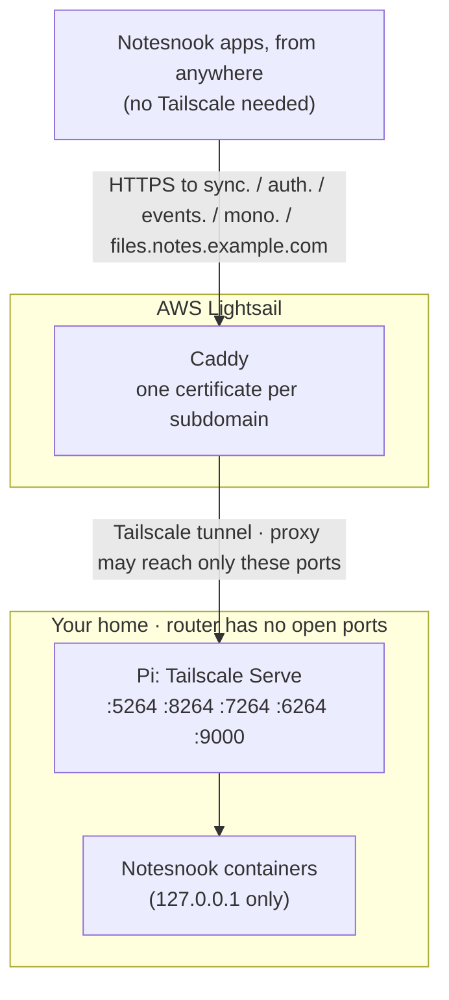

# Bonus 4: Serve Notesnook from your own domain

In bonus 3, every device that syncs needs Tailscale turned on. This bonus gives Notesnook public HTTPS addresses on your own domain, such as `https://sync.notes.example.com`, through the same Lightsail proxy as bonus 1. Then phones, computers and the web app can sync without Tailscale.

**Requires:** [bonus 1](01-custom-domain.md) (Route 53, Lightsail, Caddy and the Tailscale policy) and [bonus 3](03-notesnook.md) (Notesnook running and working over Tailscale).

**Time:** about 30–45 minutes.



> ⚠️ **Your Notesnook server becomes public.** 🕒 As of Nov 2026, the self-hosted server is still pre-release (beta). Your notes stay end-to-end encrypted, but the login and sync endpoints can be reached by anyone. Before you start:
> - `DISABLE_SIGNUPS=true` must be set (bonus 3, Step 6). Otherwise anyone could create an account on your server.
> - Two-factor login must be on for every account (bonus 3, Step 5).
> - Make a fresh app backup (bonus 3, Step 7). You'll log out and back in on every device.

## The subdomains

This guide uses one subdomain per service under `notes.<your-domain>`:

| Subdomain | Forwards to the Pi's Serve port | Service |
|---|---|---|
| `sync.notes.example.com` | 5264 | Sync server |
| `auth.notes.example.com` | 8264 | Login (identity) |
| `events.notes.example.com` | 7264 | Live updates |
| `mono.notes.example.com` | 6264 | Published notes (Monograph) |
| `files.notes.example.com` | 9000 | Attachments (Silo) |

## Step 1: One wildcard DNS record

A single **wildcard** record covers all five subdomains.

1. Open **Route 53 → Hosted zones → `<your-domain>`** and click **Create record**.
2. **Record name:** `*.notes` (shown as `*.notes.<your-domain>`). **Record type:** **A**. **Value:** `<static-ip>` (your Lightsail static IP from bonus 1). **TTL:** 300.
3. Click **Create records**.

**Check:** after a few minutes, on your laptop, `dig +short sync.notes.<your-domain>` and `dig +short files.notes.<your-domain>` both print `<static-ip>`.

Caddy still gets a separate certificate for each subdomain, automatically. The wildcard only saves you from creating five records.

## Step 2: Let the proxy reach Notesnook's ports

The bonus 1 policy lets the proxy reach only port 443 (Nextcloud) on the Pi. Add the five Notesnook ports to the same grant, and to the `tests` block.

> ⚠️ Keep an SSH session to the Pi open while you save, as in bonus 1.

In the Tailscale admin console, open **Access controls** and change the proxy's grant and the `tests` block to:

```json
	"grants": [
		// Your own devices can reach each other freely
		{"src": ["autogroup:member"], "dst": ["*"], "ip": ["*"]},

		// The proxy can reach Nextcloud (443) and Notesnook (the other five) on the Pi
		{
			"src": ["tag:proxy"],
			"dst": ["homeserver"],
			"ip":  ["tcp:443", "tcp:5264", "tcp:8264", "tcp:7264", "tcp:6264", "tcp:9000"],
		},
	],
```

```json
	"tests": [
		{
			"src": "tag:proxy",
			"accept": [
				"homeserver:443",
				"homeserver:5264",
				"homeserver:8264",
				"homeserver:7264",
				"homeserver:6264",
				"homeserver:9000",
			],
			"deny": ["homeserver:22", "homeserver:8080"],
		},
	],
```

Leave `tagOwners`, `hosts` and `ssh` as they were in bonus 1. Click **Save**. Tailscale refuses to save if the tests fail.

**Check:** on the Lightsail server (**Connect using SSH**), this prints JSON with `notesnook-sync`:

```bash
curl -s https://<hostname>.<tailnet>:5264/version
```

## Step 3: Add the subdomains to Caddy

On the Lightsail server:

```bash
sudo nano /etc/caddy/Caddyfile
```

Keep the Nextcloud block from bonus 1, and add these five blocks below it:

```
# --- Notesnook (sync server on the Pi) ---
sync.notes.<your-domain> {
    reverse_proxy https://<hostname>.<tailnet>:5264
}
auth.notes.<your-domain> {
    reverse_proxy https://<hostname>.<tailnet>:8264
}
events.notes.<your-domain> {
    reverse_proxy https://<hostname>.<tailnet>:7264
}
mono.notes.<your-domain> {
    reverse_proxy https://<hostname>.<tailnet>:6264
}
files.notes.<your-domain> {
    reverse_proxy https://<hostname>.<tailnet>:9000
}
```

Each block forwards to the Pi's **Tailscale Serve** entry for that port (from bonus 3, Step 4). Keep those Serve entries: Caddy depends on them.

Save, then reload Caddy and watch the log:

```bash
sudo systemctl reload caddy
sudo journalctl -u caddy -f
```

**Check:** within a minute or two, the log reports a certificate obtained for each of the five subdomains. Press **Ctrl + C**. Then, from your laptop, `curl -s https://sync.notes.<your-domain>/version` prints the `notesnook-sync` JSON.

## Step 4: Switch the server's public URLs

The server tells the apps where to find its parts, especially the attachments address. Those URLs must match the new public addresses.

On the Pi:

```bash
cd ~/notesnook
cp .env .env.tailnet-backup
nano .env
```

Change the four `*_PUBLIC_URL` lines to the new subdomains, with **no port numbers** (Caddy listens on the standard HTTPS port):

```
NOTESNOOK_API_PUBLIC_URL=https://sync.notes.example.com
AUTH_SERVER_PUBLIC_URL=https://auth.notes.example.com
MONOGRAPH_PUBLIC_URL=https://mono.notes.example.com
ATTACHMENTS_SERVER_PUBLIC_URL=https://files.notes.example.com
```

Also confirm that `DISABLE_SIGNUPS=true`. Save, then recreate the containers so they pick up the new settings:

```bash
sudo docker compose up -d --force-recreate
```

**Check:** after 2–3 minutes, `sudo docker compose ps -a` shows the same healthy services as in bonus 3, Step 2.

## Step 5: Point each app at the new addresses

The server fields are locked while you're logged in, so do this on each device:

1. **Log out** of Notesnook.
2. Open **Settings → Servers** and enter the new URLs:
   - Sync server: `https://sync.notes.<your-domain>`
   - Auth server: `https://auth.notes.<your-domain>`
   - Events server: `https://events.notes.<your-domain>`
   - Monograph server: `https://mono.notes.<your-domain>`
3. Click **Test connection**, then **Save**, then **log in**.

Start with the desktop app, where your backups are.

**Check:** with **Tailscale turned off** on a phone (and Wi-Fi off, to be sure you're testing the public route), your notes and an attached image load and sync.

## Rolling back

To go back to Tailscale-only access:

1. On the Pi, restore the old settings and recreate the containers:

   ```bash
   cd ~/notesnook
   cp .env.tailnet-backup .env
   sudo docker compose up -d --force-recreate
   ```

2. On each device, log out and enter the `https://<hostname>.<tailnet>:<port>` URLs from bonus 3 again.
3. **Close the public route. This step is not optional.** Changing the app URLs doesn't stop the five subdomains from answering. On the Lightsail server, delete the five Notesnook blocks from `/etc/caddy/Caddyfile` and run `sudo systemctl reload caddy`. In the Tailscale policy, set the proxy's grant and `tests` back to the bonus 1 version (port 443 only).
4. Optionally, delete the wildcard `*.notes` record in Route 53.

**Check:** from a device with Tailscale turned off, `curl -m 10 https://sync.notes.<your-domain>/version` fails, while `https://<your-domain>` still loads Nextcloud.

## Things to check against upstream

- 🕒 **`KNOWN_PROXIES` is left empty** in this setup, and it works. Behind a proxy, the server may record Caddy's address as every visitor's IP. As of Nov 2026, the release notes say forwarded-IP headers are trusted only from private or loopback addresses. Check the notesnook-sync-server docs if you need accurate client IPs, for example for rate limiting or logs.

## Troubleshooting

| Symptom | Likely cause | Fix |
|---|---|---|
| Caddy doesn't get a certificate for a subdomain | The wildcard record is missing or still propagating | `dig +short sync.notes.<your-domain>` should print `<static-ip>` |
| The subdomains time out | The Tailscale policy doesn't allow that port | Check the Step 2 grant. On the proxy, `curl -m 5 https://<hostname>.<tailnet>:5264/version` should answer. |
| `502` from Caddy | The Pi's Serve entry for that port is missing, or the service is down | `tailscale serve status` and `sudo docker compose ps` on the Pi; rerun bonus 3, Step 4 if needed |
| Notes sync but images and files don't | `ATTACHMENTS_SERVER_PUBLIC_URL` doesn't match the public address | It must be exactly `https://files.notes.<your-domain>`, with no port. Recreate the containers after fixing it. |
| **Test connection** still uses the old addresses | You're still logged in, so the fields are locked | Log out first, then change the URLs |
| Someone else could create an account | `DISABLE_SIGNUPS` isn't `true` | Set it, then `sudo docker compose up -d --force-recreate` |
